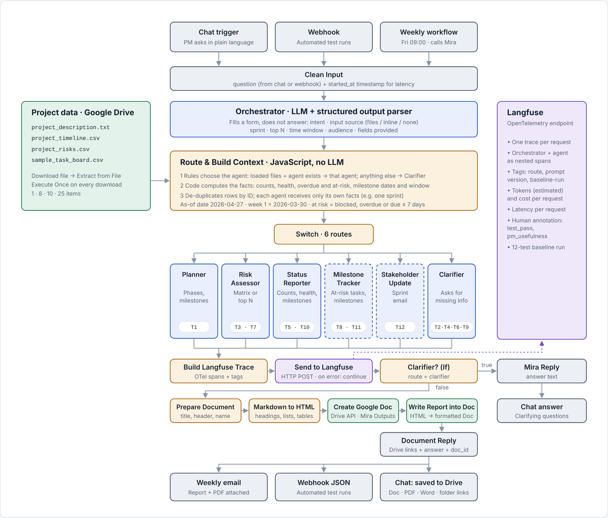

# Mira: AI Project Intelligence Assistant

Mira is a multi-agent n8n workflow that helps Nexora's PMs and TPMs run the ABCDE Ltd. AI Adoption Project. It generates project plans, risk assessments, weekly status reports, milestone alerts and stakeholder update emails, all grounded in the project's own files, and asks for missing information instead of guessing. Reports are saved to Google Drive as formatted documents with one-click PDF and Word downloads, and a scheduled workflow emails the weekly status report with the PDF attached. Every request is traced in Langfuse.

**Results:** 12 of 12 baseline tests pass in both the v1 baseline and the v2 regression run, with every request routed to the intended agent, counts matching the source files exactly, and all 4 vague requests correctly refused. See [`docs/baseline_results.md`](docs/baseline_results.md).

## How it works

**Design principle: code computes, the LLM writes.** LLMs miscount rows and get date maths wrong, so every count, date comparison and filter happens in a JavaScript Code node. Each agent receives only the facts it needs and is told to copy them exactly.

1. **Input.** A question arrives from the n8n chat, the webhook (automated tests) or the weekly workflow. *Clean Input* normalizes it and records a start time.
2. **Orchestrator** (LLM with a structured output parser) fills a form about the request: intent, input source (the loaded files, quoted text, or nothing), sprint, top N, time window and audience. It does not answer the request.
3. **Project data.** Four files are read from Google Drive (*Download file* → *Extract from File*, with *Execute Once* on each download).
4. **Route & Build Context** (code, no LLM):
   - Rules choose the agent. A request about the loaded files goes to its agent; anything vague or about another project goes to the Clarifier.
   - Code computes the facts: counts by status, a Red/Amber/Green health rule, overdue and at-risk tasks, timeline weeks converted to dates, upcoming milestones.
   - Each agent receives only its own facts, so a Sprint 2 email only ever sees Sprint 2 tasks.
   - Rows are de-duplicated by ID.
5. **Switch** sends the request to one of six agents, each a Basic LLM Chain on `gpt-4o-mini`.
6. **Langfuse.** One trace per request (OpenTelemetry endpoint), with the orchestrator and agent as nested spans, tagged by route and prompt version.
7. **Delivery.** Clarifier questions are answered in the chat. Every other answer is converted to HTML, created as a formatted Google Doc in the *Mira Outputs* Drive folder, and the chat confirms the save with links to the document, a PDF download, a Word download and the folder.

| Agent | Handles | Tests |
|---|---|---|
| Planner | Project plan from the description and timeline | T1 |
| Risk Assessor | Full risk matrix, or top N risks | T3, T7 |
| Status Reporter | Status by sprint or for the whole project: health, counts, tasks by status, needs attention, upcoming milestones | T5, T10 |
| Milestone Tracker *(extended capability)* | Blocked and at-risk tasks with suggested actions; milestones in a time window | T8, T11 |
| Stakeholder Update *(extended capability)* | Sprint update email for leadership, engineering or the client | T12 |
| Clarifier *(enhancement)* | Asks for missing information instead of guessing | T2, T4, T6, T9 |

**Orchestration pattern: Router.** Requests vary, and each needs different data and a different prompt. A sequential pipeline would run every agent on every request, costing more and letting agents answer questions nobody asked. The trade-off is that the router is a single point of failure, so its decision is recorded in every trace.

**Weekly status report.** A second workflow runs every Friday at 09:00. It calls Mira as a sub-workflow for the current sprint, converts the report to HTML, downloads the Google Doc as a PDF, and emails both with Gmail.

## Results

| Metric | v1 baseline | v2 regression |
|---|---|---|
| Tests passed | 12 / 12 | 12 / 12 |
| Correct refusals on vague input | 4 / 4 | 4 / 4 |
| Status reports with upcoming milestones | 0 / 2 | 2 / 2 |
| Average PM usefulness (human score, 1–5) | 4.5 | — |
| Average latency per request | 10.6 s | 10.2 s |
| Average cost per request | $0.00046 | $0.00050 |
| ed monthly cost (10 PMs × 8 requests/day) | $0.78 | $0.83 |

## Repository

| Path | Contents |
|---|---|
| `workflows/` | Exported n8n workflows (JSON): the main Mira workflow and the weekly status report workflow |
| `docs/Mira_Submission_Guide.pdf` | Submission guide: results, architecture, every file explained, rubric evidence, findings, future enhancements |
| `docs/architecture.png` | Architecture diagram (`architecture.html` is the interactive version) |
| `docs/baseline_results.md` | Results for all 12 tests in the v1 baseline and v2 regression runs |
| `docs/Mira_Test_Log_v2.xlsx` | Test log: per-test latency, tokens, cost and scores for both runs, v1 vs v2 comparison, findings |
| `docs/prompts.md` | All seven system prompts with version history |
| `docs/` (Q1–Q4) | Ideation, build write-up, program charter, reflection |
| `code/` | Source of the main Code nodes: routing and facts, Langfuse trace |
| `screenshots/` | Workflow canvas, Mira in chat, Drive output and PDF, Langfuse traces and scores, weekly workflow and email |
| `data/` | The input files provided with the brief |

## Setup

1. Upload the four  files in `data/` (all except `eval_mira_inputs.txt`) to a Google Drive folder, and create a second folder named **Mira Outputs**.
2. In n8n, import both JSON files from `workflows/` (*Workflows → Import from file*).
3. Add credentials:
   - **OpenAI** on the seven OpenAI Chat Model nodes
   - **Google Drive** on the four *Download* nodes and the two Drive API nodes. In the credential's settings, allow the domains `googleapis.com` and `www.googleapis.com`. Reselect each  file in the Download nodes.
   - **Basic Auth** on *Send to Langfuse* (username = Langfuse public key, password = secret key)
   - **Gmail** on the weekly workflow's *Send email* node
4. Set the **Mira Outputs** folder ID in *Create Google Doc* and *Document Reply*. In *Send to Langfuse*, use your region's endpoint, for example `https://us.cloud.langfuse.com/api/public/otel/v1/traces`, with the header `x-langfuse-ingestion-version: 4`.
5. In the weekly workflow, reselect the main workflow in *Call Mira Base*.
6. Activate the main workflow, open the chat and ask: *Summarize the current  status: how many tasks are done, in progress, and to do?* Expected: Done 5, In Progress 3, Blocked 1, To Do 16, with a confirmation that the report was saved to Drive.

## Assumptions

| Setting | Value | Why |
|---|---|---|
| As-of date | 2026-04-27 | The files have no current date and the real date is after the  ends; a fixed date keeps tests repeatable |
| Week 1 start | 2026-03-30 | Not in the files; aligns Sprints 1–3 with Phases 1–3 |
| At risk | Blocked, overdue, or open and due within 7 days | Not defined in the brief |
| Upcoming | The next 14 days, unless the user names a window | "Next 2 weeks" in T11 |
| Top risks | LLM judgment against the stated goals | The risk register has no likelihood or severity column |
| Tokens | Estimated (characters ÷ 4) | The trace is built from data n8n passes along |

## Key findings

- The brief's summary says 3 tasks are Done; the task board has **5**. Mira reports the data.
- A Download node without *Execute Once* re-read a file once per upstream item, inflating counts **80 times**. Fixed with *Execute Once* on every download, plus de-duplication by ID in code.
- Langfuse rejected its legacy ingestion API for new projects, so traces are sent through its OpenTelemetry endpoint.
- Re-running a test changed the wording, but never the facts, because the facts are computed in code.
- The v1 status report lacked upcoming milestones, a core requirement. v2 added them; the regression run confirmed it in 2 / 2 status reports with no other test affected.
- n8n Cloud's managed Google credential blocks HTTP Request nodes until the Google API domains are allowed in its settings.
- Known limit: the router sends each request to one agent. A request with two intents ("plan and top risks") gets one answer.

The full list is in the *Findings* tab of `docs/Mira_Test_Log_v2.xlsx`.

## Future enhancements

- Let the user choose in the chat how to receive each answer: view in chat, download a PDF, or email it
- PM approval (Approve/Reject) before the weekly report reaches stakeholders
- v3 prompt fixes for the six remaining defects, and a grounding validator that checks every task and risk ID against the files
- A fine-tuned Risk Assessor trained on corrected answers collected from traces
- Resource Allocation Advisor, multi-intent requests, and a live Jira or Trello task board
